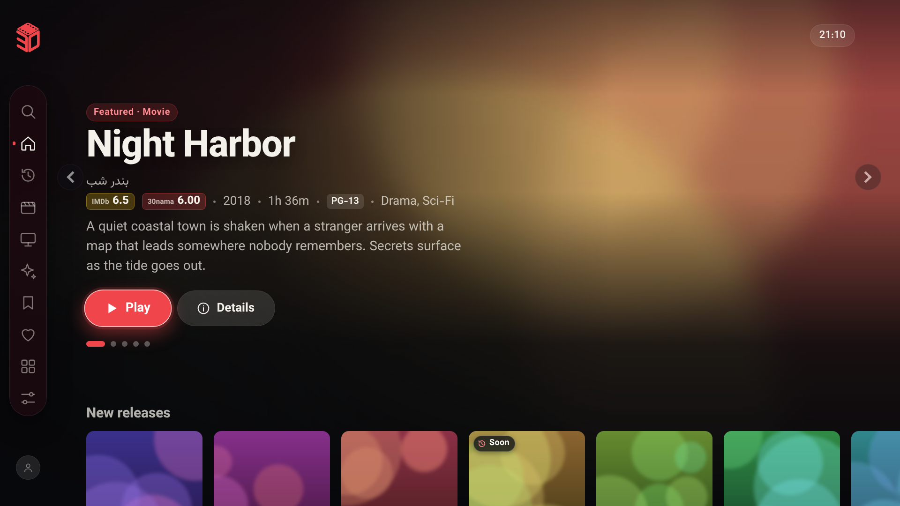
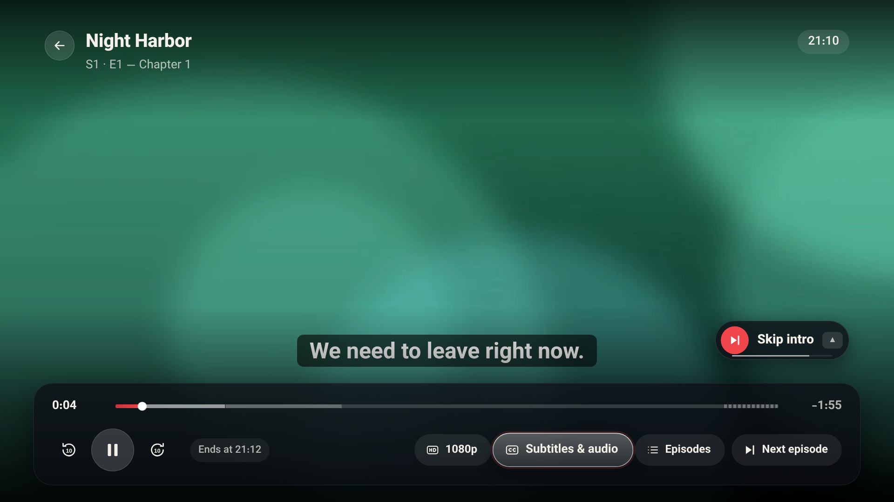
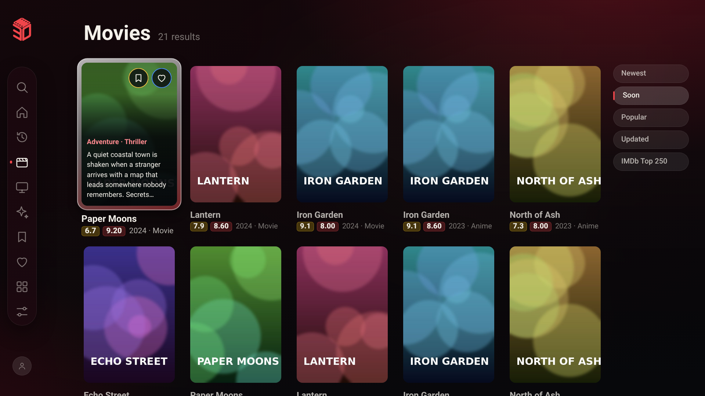
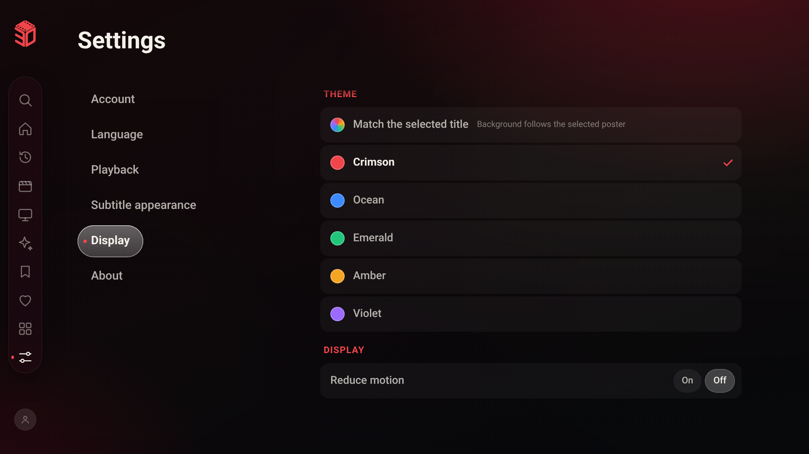
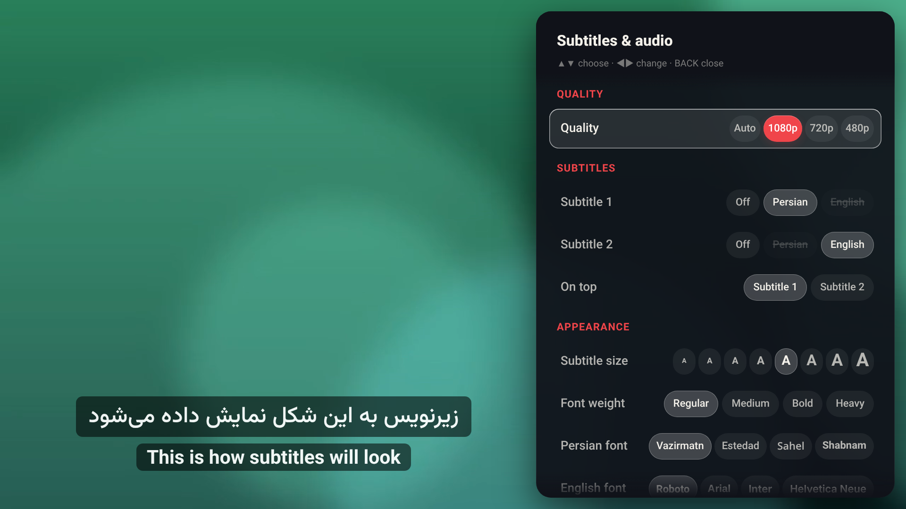
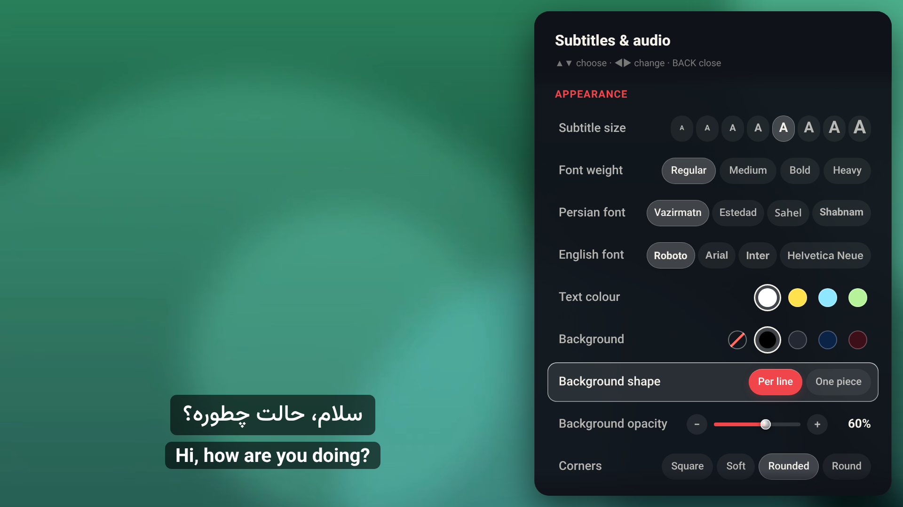
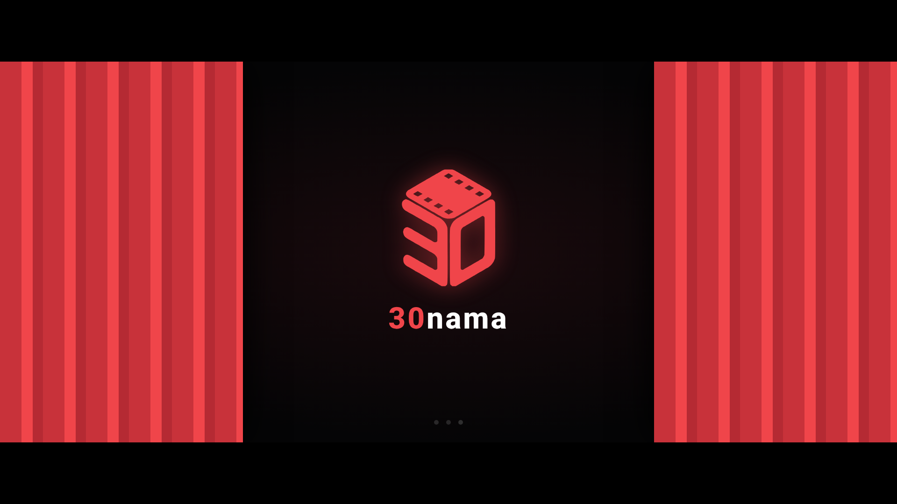
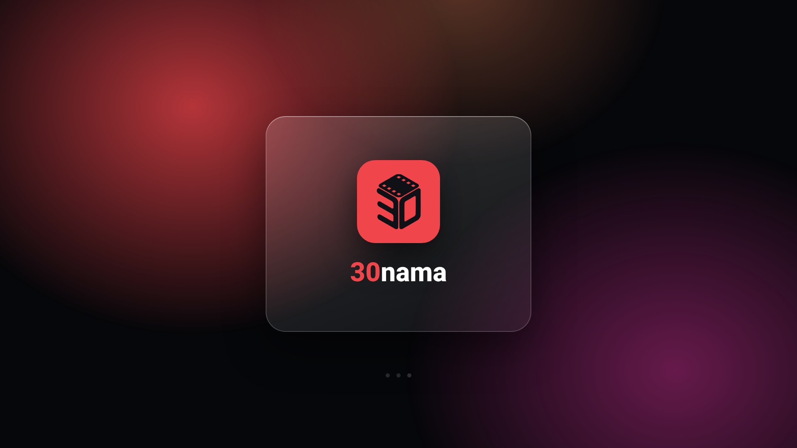

**[⬇️ Download the latest version (v1.10.1)](https://github.com/Davoudr-Apps/30nama/raw/main/dist/com.nama30.webos_1.10.1_all.ipk)**

Install on the TV (Developer Mode on): `ares-install --device tv com.nama30.webos_1.10.1_all.ipk`

Thanks to [mamali6](https://github.com/mamali6) for [30nama-webos](https://github.com/mamali6/30nama-webos) which was used as base code for applying the customizaitons.

## Features

30nama for webOS provides a redesigned, Persian-first TV interface with browsing, watchlists, ratings, themes, a streamlined video player, and dual-subtitle customization.

- Six launch screens to choose from in Settings, a new app icon, and posters that show their title only when selected.
- Read the full feature list and release notes in [FEATURES.md](FEATURES.md).
- Preview the interface in the [screenshots gallery](screenshots/).

| Home | Player | Soon |
|---|---|---|
|  |  |  |

| Themes | Subtitles panel | Subtitle appearance |
|---|---|---|
|  |  |  |

| Launch screen: Curtain & Letterbox | Launch screen: Persian Wordmark | Launch screen: Aurora Glass |
|---|---|---|
|  |  |  |

# LG OLED B5 — webOS Developer Mode & CLI Setup Guide

This guide explains how to connect an WebOS LG TV to a Mac using the webOS CLI (`ares-*` tools), enable Developer Mode, configure SSH access, and install applications outside the LG Content Store.

## 1. Requirements

- LG OLED B5 running webOS
- Mac with webOS CLI installed
- LG Developer Account
- Developer Mode app installed on the TV
- Mac and TV connected to the same local network

## 2. Enable Developer Mode on LG TV, take IP and passphrase

1. Open **LG Content Store / Apps** on the TV.
2. Search for and install **Developer Mode**.
3. Launch the app.
4. Sign in using your LG Developer Account.
5. Enable **Dev Mode Status = ON**.
6. Enable **Key Server = ON**.
7. Find and record the TV's local IP address.
8. Keep the Developer Mode app available to retrieve the passphrase when requested.

**LG Developer website:** https://webostv.developer.lge.com/

> Important: Developer Mode sessions expire and must be extended periodically. Expiration can remove sideloaded applications.

## 3. Add the TV Using ares-setup-device

Open Terminal on your Mac:

```bash
ares-setup-device
```

Select the `add` option and configure the connection:

| Setting              | Value                                          |
| -------------------- | ---------------------------------------------- |
| Device Name          | `LG_B5` (as the example)                       |
| Device IP Address    | Your TV's local IP address                     |
| Device Port          | `9922`                                         |
| SSH Username         | `prisoner`                                     |
| Description          | `LG OLED B5`                                   |
| Authentication       | `ssh key`                                      |
| SSH Private Key File | Use the key configuration supported by the CLI |
| Default Device       | `Yes`                                          |
| Save Configuration   | `Yes`                                          |

### Key configuration

```text
Device Name:       LG_B5
Device IP:         <TV_IP_ADDRESS>
Device Port:       9922
SSH Username:      prisoner
Description:       LG OLED B5
Authentication:    SSH Key
```

**Port `9922`** is the standard SSH port for LG webOS Developer Mode. You do not need to look it up in TV settings.

**Username `prisoner`** is used for standard Developer Mode access on an unrooted LG TV.

## 4. Retrieve the SSH Key

Run:

```bash
ares-novacom -d LG_B5 --getkey
```

When prompted, enter the passphrase displayed in the TV's Developer Mode application.

The command retrieves the SSH key required for authentication.

> The Developer Mode passphrase is used to retrieve the SSH key. It is not the normal SSH account password.

## 5. Verify Device Configuration

List configured devices:

```bash
ares-setup-device --list
```

Expected output will resemble:

```text
name       deviceinfo                    connection
LG_B5      prisoner@192.168.1.100:9922   ssh
```

The example IP address should be replaced with the TV's actual IP.

## 6. Test the Connection

Execute a command on the TV:

```bash
ares-novacom -d LG_B5 --run "echo connected"
```

Expected output:

```text
connected
```

If this works, your Mac can communicate with the LG TV through the webOS development interface.

## 7. Install Applications (.ipk)

To bring the app to your local machine, open Terminal on your Mac:

```bash
cd /Users/<YOUR_USERNAME>/Documents/
git clone https://github.com/Davoudr/30nama.git
cd 30nama
./build.sh
```

Now, you have the application file to install in the following path:
`/Users/<YOUR_USERNAME>/Documents/30nama/dist`

To install the compatible webOS application:

```bash
ares-install -d LG_B5
```

(before pressing the Enter, drag the file from `/Users/<YOUR_USERNAME>/Documents/30nama/dist` and drop it in termina and then press Enter)

List installed applications:

```bash
ares-install -d LG_B5 --list
```

🙂‍↕️ Now you should see the icon of this app in your TV's menu. 🙂‍↕️

Uninstall an application:

```bash
ares-install -d LG_B5 --remove com.example.app
```

> Only compatible webOS packages (`.ipk`) can be installed using this method. Android `.apk` files are not supported.

## 8. Useful Commands

| Command                                        | Purpose                      |
| ---------------------------------------------- | ---------------------------- |
| `ares-setup-device`                            | Add or manage TV connections |
| `ares-setup-device --list`                     | List configured devices      |
| `ares-novacom -d LG_B5 --getkey`               | Retrieve SSH key             |
| `ares-novacom -d LG_B5 --run "echo connected"` | Test connection              |
| `ares-install -d LG_B5 app.ipk`                | Install an application       |
| `ares-install -d LG_B5 --list`                 | List applications            |
| `ares-launch -d LG_B5 <APP_ID>`                | Launch an application        |
| `ares-install -d LG_B5 --remove <APP_ID>`      | Remove an application        |

## 9. Troubleshooting

### Connection refused

- Check that Developer Mode is enabled.
- Make sure Key Server is enabled.
- Verify TV IP address.
- Confirm port is `9922`.
- Ensure Mac and TV share the same local network.

### Authentication failed

- Run `ares-novacom -d LG_B5 --getkey` again.
- Enter the current passphrase shown on the TV.
- Confirm SSH username is `prisoner`.
- Verify the SSH key path in the device configuration.

### Device not found

Run:

```bash
ares-setup-device --list
```

Make sure the configured device name matches `LG_B5`.

### App installation failed

- Confirm the file is a valid webOS `.ipk`.
- Check compatibility with your webOS version.
- Confirm the Developer Mode session is active.
- Verify there is enough storage available.

## 10. Homebrew and Advanced Customization

Useful projects:

**webOS Homebrew**

https://www.webosbrew.org/

Unofficial homebrew applications and utilities for LG webOS TVs.

**webOS Dev Manager**

https://github.com/webosbrew/dev-manager-desktop

Desktop application for managing webOS devices and installing compatible applications.

**webOS Rooting**

https://www.webosbrew.org/rooting/

Information about obtaining privileged access to supported LG webOS firmware.

**jsbro-autoroot**

https://github.com/raws0kil/jsbro-autoroot

Community rooting research and tools. Compatibility must be verified for the exact TV firmware before attempting any rooting procedure.

## 11. Important Limitations

- Installing unofficial webOS applications does not require replacing the operating system.
- Developer Mode provides limited access; it does not provide root access.
- Root access does not automatically enable Android APK installation.
- Google Chrome is not officially available as a native LG webOS application.
- A compatible webOS browser port would be required to use an alternative browser.
- Rooting can introduce security, stability, and warranty risks.
- Android/Google TV streaming devices are an alternative for running Android applications.

## 12. Official Documentation

- LG webOS Developer: https://webostv.developer.lge.com/
- webOS Homebrew: https://www.webosbrew.org/
- webOS Dev Manager: https://github.com/webosbrew/dev-manager-desktop

---

**Device:** LG OLED
**OS:** LG webOS  
**Connection:** SSH over local network  
**SSH Port:** `9922`  
**SSH Username:** `prisoner`  
**CLI Device Name:** `???`  
**Application Package Format:** `.ipk`
